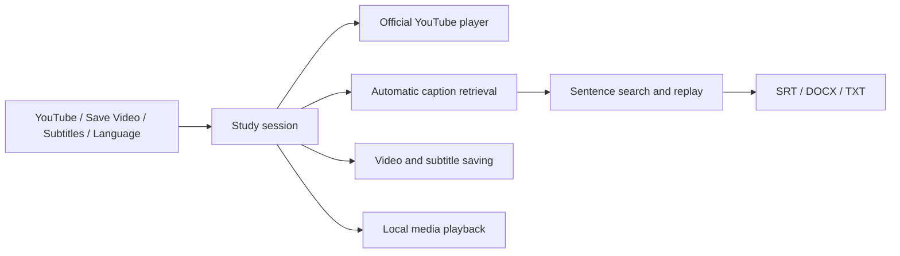

<p align="center">
  
</p>

<h1 align="center">AxonTube<br>Learn the World's Languages Faster with AI.</h1>

<p align="center"><strong>Turn YouTube into Your Personal Language Classroom.</strong></p>

<p align="center">
  
  
  
  <a href="LICENSE"></a>
  
</p>

**English** · [简体中文](README.zh-CN.md) · [繁體中文](docs/guides/zh-Hant.md) · [日本語](docs/guides/ja.md) · [한국어](docs/guides/ko.md) · [Español](docs/guides/es.md)

[Français](docs/guides/fr.md) · [Deutsch](docs/guides/de.md) · [Italiano](docs/guides/it.md) · [Português](docs/guides/pt.md) · [Русский](docs/guides/ru.md) · [العربية](docs/guides/ar.md)

[हिन्दी](docs/guides/hi.md) · [Türkçe](docs/guides/tr.md) · [Tiếng Việt](docs/guides/vi.md) · [ไทย](docs/guides/th.md) · [Bahasa Indonesia](docs/guides/id.md) · [Nederlands](docs/guides/nl.md)

[Polski](docs/guides/pl.md) · [Українська](docs/guides/uk.md) · [Svenska](docs/guides/sv.md) · [Dansk](docs/guides/da.md) · [Suomi](docs/guides/fi.md) · [עברית](docs/guides/he.md)

[Highlights](#highlights) · [Features](#available-features) · [Quickstart](#quick-start) · [Open issues](#open-issues) · [Development](#documentation-and-development)

**Watch what you love. Learn the languages you want.**

Use YouTube captions and automatic translations to learn from videos you love: read two languages side by side, replay each sentence, and keep the material that matters.

**24 interface languages · Multilingual subtitles**

> **0.5.3 · macOS preview for Apple silicon.** The latest YouTube download check encountered sign-in / bot verification. Current online retrieval still needs live validation.

**[Download DMG](https://github.com/axonvoss-labs/AxonTube/releases/download/v0.5.3/AxonTube-0.5.3-macos-arm64.dmg)** · [Download ZIP](https://github.com/axonvoss-labs/AxonTube/releases/download/v0.5.3/AxonTube-0.5.3-macos-arm64.zip) · [SHA-256 checksums](https://github.com/axonvoss-labs/AxonTube/releases/download/v0.5.3/SHA256SUMS.txt) · [Release notes](https://github.com/axonvoss-labs/AxonTube/releases/tag/v0.5.3)

Requires an Apple silicon Mac; macOS 14 is the deployment target. This preview is ad-hoc signed and is not notarized by Apple. Read the [installation instructions](docs/INSTALL.md) before opening it. Source builds remain available below.


*Actual app window with the bundled local demo, English and Traditional Chinese subtitles. This screenshot demonstrates local playback.*

<details>
<summary>More screenshots: welcome, subtitle controls, YouTube</summary>

### Welcome and main workflow


The four toolbar actions, two visible subtitle selectors, localized slogan, and clear disabled state before a video is opened.

### First and second subtitle


Actual English-interface capture of the independent subtitle dropdowns, defaulting to English and Traditional Chinese.

### Open a YouTube link


Actual English-interface capture of the link dialog. Opening a link starts playback and requests the selected caption pair.

</details>

## Highlights

- **A short path from watching to practising** — Four toolbar actions keep the main flow direct: YouTube → Save Video → Subtitles → Language. No extra caption-fetch button is needed.
- **Learning material you can keep** — Timed captions and readable Word / TXT files support both listening practice and later review. Exports use new destinations and preserve original files.
- **Local work, no AI API key** — Local media and saved subtitles work offline. YouTube supplies website captions and automatic translations; the app has no telemetry and does not upload local media or require a paid AI API key.

## Available features

| Feature | What you can do |
| --- | --- |
| Two independent subtitle tracks | English / Traditional Chinese defaults; choose from the current video's available originals and automatic translations. Successful first-track captions remain usable if the second track fails. |
| Sentence-focused practice | Sentence search, click-to-seek, previous / next, replay, looping, playback speed, and following the current sentence. |
| Video with synchronized subtitles | Saving stays available while captions load. Each operation creates a new folder for accessible video; timed SRT tracks and bilingual reading files are added when captions are available. Video-only saving is supported. Incomplete work stays in a .partial folder. |
| Word, TXT, and SRT export | Export available subtitles with timing offsets applied. Word and TXT pair text by time overlap. If only one track is loaded, its content can still be exported. |
| 24 localized interfaces | Menus, status messages, and the learning slogan switch languages together. Arabic and Hebrew support right-to-left layouts; subtitle content is not changed by switching the interface. |
| Local playback and clear controls | Open local media and subtitle files from the File menu. Disabled actions are dimmed with reasons; selected modes have highlights and checkmarks; saving shows a busy state. |

24 counts interface choices. Subtitle languages depend on the selected video's available tracks; it is not a promise of fluency in 24 languages.

## Quick start

1. **Open YouTube:** Paste a video link. Available captions are requested automatically, with English first and Traditional Chinese second. Initial retrieval may take about 1–2 minutes; availability is not guaranteed.
2. **Choose and practise:** Use the two visible subtitle dropdowns. Click a sentence to jump to it, replay it, or enable a sentence loop.
3. **Save or export:** Save Video chooses a folder for accessible media and available subtitles. Export Bilingual Subtitles creates Word, TXT, or SRT from loaded captions.
4. **Make it yours:** Change interface language, playback speed, subtitle size, and each track's timing offset. The app remembers interface and subtitle-language choices.

## Open issues

| Priority | Issue | Current status / next step |
| --- | --- | --- |
| P0 | YouTube caption and video availability | The latest live check hit YouTube's sign-in / bot-verification requirement. Successful current online downloads have not been established. Validate under the intended network and across representative videos before public release. |
| P1 | Embedding and account-restricted videos | Some authors or videos disallow embedded playback. In-app Google SSO is not implemented; the browser shortcut uses a separate login and playback session. These restrictions cannot be presented as solved. |
| P1 | Signing and broader Mac testing | The package is ad-hoc signed, without Developer ID notarization. Apple Silicon on macOS 26.5.2 was tested; macOS 27 and Intel Macs were not. macOS 14 is a deployment target, not proof that every version has been tested. |
| P2 | Download quality and subtitle fidelity | Saving uses a complete audio/video stream and does not merge separate high-resolution streams. ASS/SSA imports text only. Automatic captions, translations, and timing-based bilingual pairing may contain errors. Local playback depends on codec support; optional FFmpeg conversion may omit extra audio tracks, HDR, and embedded subtitles. |
| P2 | Learning-history and study tools | Playback-history restoration, vocabulary collections, spaced review, OCR, and image-subtitle extraction are not implemented. Saved language preferences are not saved learning progress. |
| P2 | Native-speaker language review | All 24 interface choices and localized slogans passed switching checks. That establishes coverage and behavior, not professional native-speaker review of every translation. |

## Verification

For 0.5.3: 105 core checks, 138 model assertions, 29 caption checks, 60 video-save checks, and 317 native-interface assertions passed. All 24 language choices were selected in the actual menu; six interface languages and compact German layouts were reviewed.

Local playback, exports, state transitions, and native save dialogs were verified. Offline fixtures and fake-helper save tests do not prove that YouTube currently permits online caption or video downloads. No user credentials were imported.

[Detailed verification record](docs/VERIFICATION.md)

## Documentation and development

<details>
<summary>Usage details: subtitles, controls, saving and export</summary>

### Four actions

The toolbar follows this order: **YouTube → Save Video → Subtitles → Language**.

1. **YouTube:** paste a video link and open it. The app automatically requests
   English as the first subtitle and Traditional Chinese as the second. The
   first track appears as soon as it is ready; automatic translation typically
   takes another minute or two. There is no separate caption-download button.
2. **Save Video:** choose a destination to keep the video and synchronized
   subtitle files together for local use. This is an explicit download action;
   opening a YouTube video alone streams it. Saving is available once a video
   is open, including while subtitles are still loading or after a subtitle error.
3. **Subtitles:** adjust subtitle timing and appearance when needed.
   **Export Bilingual Subtitles**, above the sentence list, saves SRT, Word
   `.docx`, or UTF-8 `.txt`.
4. **Language:** open the menu to see all 24 interface languages directly.
   English is the default. The app remembers your interface choice, independently
   of subtitle content.

**First subtitle** and **Second subtitle** stay visible above the sentence list.
Their dropdowns default to English and Traditional Chinese and list the current
video's available tracks. Choosing a language requests the new pair automatically.

Unavailable controls are visibly dimmed, with a reason shown near playback or
saving. Selected modes are highlighted; menu choices use checkmarks so the
current language, speed, and subtitle mode are easy to recognize.

Click a subtitle sentence to seek to it, repeat it, or loop it. Search both tracks,
adjust playback speed, and correct each track's time offset. Captions and the
sentence list have separate text-size controls.

YouTube provides the website captions and automatic translations. AxonTube uses
its bundled yt-dlp helper to request those tracks; it does not call ChatGPT,
Claude, or a paid translation API and does not need an AI API key. Available
subtitle languages depend on the selected video. Traditional Chinese is never
silently replaced with Simplified Chinese.

### Languages

The interface supports English, Simplified Chinese, Traditional Chinese,
Japanese, Korean, Spanish, French, German, Italian, Portuguese, Russian, Arabic,
Hindi, Turkish, Vietnamese, Thai, Indonesian, Dutch, Polish, Ukrainian, Swedish,
Danish, Finnish, and Hebrew. Arabic and Hebrew use right-to-left layouts.

The interface list does not limit YouTube subtitle languages. Changing the
interface does not translate or replace subtitle text. macOS dialogs, external
errors, and the official YouTube player can use their own language settings.

### Saving and export

**Save Video** and subtitle export are separate actions. Save Video keeps a
local video with synchronized subtitle sidecars in the chosen destination.
Subtitle export produces a reading document or timed subtitle file from the
captions currently available in the study session.

Saving starts the video download immediately. If subtitles are still loading,
the same save waits for that request to finish and includes the available
tracks. If one or both tracks remain unavailable, the result says so; a subtitle
failure does not prevent saving an accessible video.

Each save creates a new folder containing `video.<ext>`, `video.primary.srt`,
`video.secondary.srt` for the tracks present, and
`subtitles.bilingual.srt`, `.txt`, and `.docx` when subtitles are available.
Subtitle sidecars preserve the original cue timing with your offsets applied once. The remembered destination
opens again on the next save. A failed or cancelled operation retains its
`.partial` folder and any subtitles already written.

YouTube saving selects an available complete audio/video format, preferring MP4,
without requiring FFmpeg. It does not merge separate high-resolution streams;
quality depends on the complete formats YouTube makes available. A local video
can also be copied, with subtitles when loaded.

Separate subtitle exports preserve the selected sentence-grouping mode and subtitle time offsets.
SRT follows the tracks' timing boundaries. Word and TXT pair cues by time overlap
and retain unmatched text. If only one track is loaded, its content can still be exported. Search
filters and subtitle visibility do not discard content from the export. Export
snapshots do not change if a later subtitle request finishes while a save dialog
is open.

The File menu retains local-media playback and subtitle-file import for existing
files. These are optional; the YouTube flow gets its subtitles automatically.
The included silent geometry demo exercises playback and timed captions.

</details>

<details>
<summary>Requirements, build and architecture</summary>

### Requirements

| Component | Requirement |
| --- | --- |
| Current build | Apple Silicon Mac; Intel is unverified |
| Playback and YouTube captions | macOS 14 or later deployment target |
| Build tools | Apple tools with the macOS 26 SDK; Python 3 for check scripts |
| YouTube | Internet access and a video available to the requested operation |
| Optional conversion | Separately installed FFmpeg |

A deployment target does not mean every system version has been tested. The
source also retains Apple on-device speech and translation components for
macOS 26, but they are not part of the simplified YouTube toolbar or automatic
website-caption flow.

### Build and run

The Swift package has no external package dependencies.

```sh
git clone --branch axontube https://github.com/axonvoss-labs/AxonTube.git
cd AxonTube

# Explicitly prepare the pinned, self-contained release helper.
python3 scripts/prepare-release-helper.py --download \
  --cache dist/helper-downloads --output dist/release-helper-arm64

swift build -c release
python3 scripts/check-core.py
python3 scripts/check-model.py
python3 scripts/check-captions.py
python3 scripts/check-video-save.py

bash scripts/package.sh --skip-build --helper-dir dist/release-helper-arm64 \
  --output-dir dist/app-0.5.3
open "dist/app-0.5.3/AxonTube.app"

# Produce distributable archives and checksums in a new directory.
bash scripts/package-release.sh --app dist/app-0.5.3/AxonTube.app \
  --helper-dir dist/release-helper-arm64 --output-dir dist/release-0.5.3
```

Preparation requires an Apple silicon Mac. Output directories must be new;
earlier packages are preserved. Packaging generates the app icon, strips
private build paths, and checks the copied helper manifest. Packaging itself
does not download dependencies. The preview app uses an ad-hoc
signature, not Developer ID signing or notarization. A full Xcode installation
can run `swift test`; the check scripts also support Command Line Tools without
XCTest and report their results separately.

### Architecture



See the [code map](docs/ARCHITECTURE.md) for session isolation, caption selection,
cache validation, saving, and export snapshots.

</details>

<details>
<summary>Network, privacy and format limits</summary>

### Service and privacy boundaries

Local media and saved subtitles work offline. AxonTube has no telemetry and
uploads no local media. Opening a YouTube link starts official embedded playback
and automatic caption retrieval. **Save Video** starts a media download only
after you choose that action and its destination.

YouTube may restrict embedding, captions, translations, or media downloads.
The app displays failures, retains successfully loaded captions, and does not
silently retry, import browser credentials, or bypass sign-in. Its browser
shortcut opens the original video in your browser; that browser's login and
playback clock remain separate from the embedded player.

A subtitle cache is not an offline video. Local playback requires a saved video;
a successful metadata response alone proves neither subtitles nor media can be
downloaded. Current live-service evidence is documented in
[Verification](docs/VERIFICATION.md).

</details>

[English guide](docs/guides/en.md) · [简体中文说明](docs/guides/zh-Hans.md) · [繁體中文說明](docs/guides/zh-Hant.md) · [Architecture](docs/ARCHITECTURE.md) · [YouTube details](docs/YOUTUBE.md)

All language editions are repository Markdown pages. An optional [offline HTML guide](docs/product-guide.html) is included for local browsing after download.

## License

Application code uses the [MIT License](LICENSE). Third-party components retain
their own terms; see [NOTICE](NOTICE.md) and [source access](docs/SOURCE-ACCESS.md).
AxonTube is not affiliated with YouTube, Google, or Apple.
