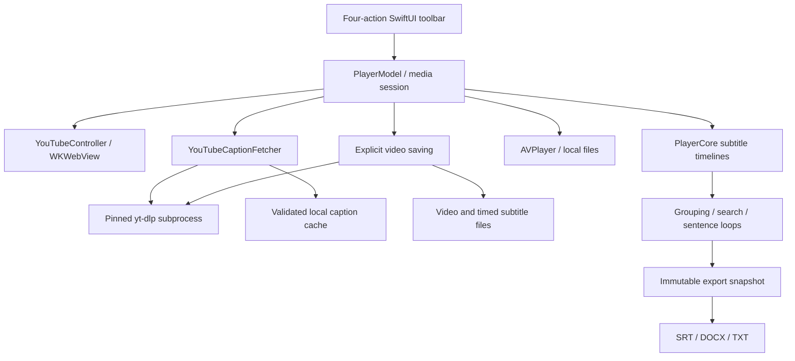

# Architecture

AxonTube separates the study session, media backends, and deterministic subtitle
operations. The native application target is `AxonTube`; parsing, timing,
caption selection, and export formats live in `PlayerCore`.

## Main flow

The toolbar contains four actions in order: **YouTube → Save Video → Subtitles →
Language**. Opening a YouTube link starts official embedded playback and requests
both subtitle tracks automatically. Their initial languages are English (`en`)
and Traditional Chinese (`zh-Hant`). The sidebar keeps **First subtitle** and
**Second subtitle** dropdowns visible above export and search. **Subtitles**
contains timing and appearance settings. No separate fetch or discovery step is
required. Bilingual export sits above the sentence list.
The Language menu directly lists all 24 interface languages.

Controls distinguish availability from selection. Shared button styles read
SwiftUI's enabled state; unavailable actions are dimmed and explain the missing
prerequisite. Playback controls require a ready player, while Save Video keeps
its independent media/save-state condition. Selected loop and follow controls
use a contrasting fill and a checkmark. Language and playback-rate menus mark
one current choice; the two subtitle tracks remain independent.

The welcome headline and supporting learning message use the same localization
catalog as the controls. The advertised count of 24 refers to interface choices;
the subtitle languages offered by each video still come from its metadata.

## Playback and study state

[`PlayerModel`](../Sources/AxonTube/PlayerModel.swift) owns the selected media,
subtitle slots, timing offsets, search, playback speed, and sentence loop.
`YouTubeController` uses the official IFrame API through a WebKit message bridge;
local media uses AVFoundation. Media-session identifiers reject late callbacks
from a video that has already been replaced.

[`SubtitleTrack`](../Sources/PlayerCore/Subtitle.swift) resolves the
active cue from playback time. Sentence grouping retains source cue IDs and real
time ranges; it does not invent word-level timestamps. Disabling grouping can
restore the original cue arrangement.

Local-file and subtitle-import actions remain in the File menu. They are not a
prerequisite or an extra step in the YouTube flow.

## Automatic website captions

[`YouTubeCaptionPlan`](../Sources/PlayerCore/YouTubeCaptionPlan.swift) catalogs
safe WebVTT tracks reported by the selected video and constructs explicit helper
arguments. Catalog entries retain the language, source, and distinction between
manual captions, original automatic recognition, and automatic translations.
An exact track ID chooses that source variant; a language-only request prefers
an appropriate manual or original track before a translation.

[`YouTubeCaptionFetcher`](../Sources/AxonTube/YouTubeCaptionFetcher.swift)
executes the helper and delivers the first track before the second. The same
metadata populates the subtitle language choices. Choosing another language
starts a fresh retrieval; the app does not require separate **Load languages**
or **Get captions** actions. Loaded tracks retain accurate labels while a new
request is pending. Generation and selected-language checks reject stale results.

The second-track selector tries to match the first track's underlying source
for automatic translation. It must not silently use an unrelated automatic
translation. Manual or original second tracks remain usable. Traditional and
Simplified Chinese are separate choices; absence of one must not be disguised
by returning the other.

Automatic translations have a bounded delay before retrieval, reflecting prior
request-limit behavior. Failure of the second track leaves the successful first
track available. No automatic retry loop or browser credential import is added.

The cache key covers the video, schema, and ordered pair of language/source
choices. A manifest ties the request to selected tracks and content hashes. A
modified first-track file cannot reuse an obsolete second-track pairing. Cached
subtitles can avoid a request but do not make the YouTube video available offline.

This path uses YouTube's website captions and automatic translations. It does
not call the public YouTube Data API, ChatGPT, Claude, or a paid AI service.

## Explicit video saving

[`VideoSaveController`](../Sources/AxonTube/VideoSaveController.swift) manages
Save Video separately from playback and automatic subtitle retrieval. The user
chooses a destination, and the app starts saving media immediately. The action
requires an open video and no other active save; caption loading, absence, or
failure does not disable it. Settled captions are captured as a snapshot. If
the current pair is still loading, the save waits up to 420 seconds for that
same request while downloading media. Timing offsets are captured when the
destination is selected. Changing videos or subtitle languages does not mix
later requests into the save. Only tracks received for its captured request are
included after a timeout or request change. Completion distinguishes two tracks,
one available track, and video without subtitles.

The controller creates a unique `AxonTube <video ID or filename> <UUID>.partial`
folder and saves media alongside subtitle sidecars. Success renames the
folder without `.partial`; cancellation or failure retains the partial files.
Outputs include `video.<ext>`, available `video.primary.srt` and
`video.secondary.srt`, plus `subtitles.bilingual.srt`, `.txt`, and `.docx` when
subtitles are available. The video snapshot keeps raw cue divisions and applies
offsets exactly once, independent of the sentence-grouping presentation.

[`VideoSavePlan`](../Sources/PlayerCore/VideoSavePlan.swift) selects
`best[ext=mp4]/best`: one complete audio/video stream, without FFmpeg merging.
A local video is copied instead of downloaded and does not require captions.
All outputs are new files in the selected destination. The original media, source
subtitle files, and caption cache remain protected. A media-download failure is
reported as a failure; metadata availability alone is not success. The app does
not use browser cookies, bypass account restrictions, or add uncontrolled retries.

The exact local validation results are listed in
[Verification](VERIFICATION.md). Online-service availability requires a separate
runtime check; deterministic subprocess and export tests cannot establish it.

## Export snapshots

[`SubtitleExportSnapshot`](../Sources/AxonTube/SubtitleExportSnapshot.swift)
captures current subtitle content, grouping, and shifts when export starts.
A later fetch or playback change cannot silently modify that output. The model
checks destination aliases to prevent overwriting source media or subtitles.

[`SubtitleExporter`](../Sources/PlayerCore/SubtitleExporter.swift) generates SRT
from actual timeline boundaries. [`SubtitleDocumentExporter`](../Sources/PlayerCore/SubtitleDocumentExporter.swift)
generates TXT and DOCX by pairing cues with time overlap and preserving unmatched
text. DOCX is written as an OOXML ZIP without launching Microsoft Word. Time
overlap is a layout heuristic, not proof that a translation is semantically exact.

## Interface languages

[`AppLocalization`](../Sources/PlayerCore/AppLocalization.swift) defines 24
interface choices with native display names, persisted independently of subtitle
languages. English is the default. The menu enumerates the entire list directly.
English and Simplified Chinese source labels pass through `L10n`, with the other
languages provided by [`LocalizationCatalog`](../Sources/PlayerCore/LocalizationCatalog.swift).
Traditional Chinese resolves locally; Arabic and Hebrew use right-to-left layout.

Asynchronous messages retain `LocalizedText` segments so visible statuses change
language without resetting playback. Verbatim segments preserve filenames,
subtitle content, and external diagnostics. Interpolated user data is protected
from text conversion and template substitution. Unknown external diagnostics may
remain in their original language.

## Retained on-device components

The source retains `LiveCaptionController`, `LiveSpeechEngine`, `LocalAudioFeed`,
and Apple Translation integration from the earlier implementation. Their support
requirements and lifecycle rules remain separate from website captions. They do
not appear in the simplified primary toolbar or run to fetch YouTube translations.
No model preparation or audio capture is triggered by opening a YouTube link.

## Testing and dependencies

[`Tests/PlayerCoreTests`](../Tests/PlayerCoreTests/) covers deterministic timing,
formats, links, caption selection, transcript revisions, grouping, localization,
and export. The [core harness](../scripts/check-core.py) supports Command Line
Tools without XCTest; the [model harness](../scripts/check-model.py) checks app
state with isolated preferences and temporary files.

Tests do not prove YouTube availability, installed speech models, capture
permission, or correct rendering on another Mac. Current evidence and gaps belong
in [Verification](VERIFICATION.md).

The Swift package has no external package dependencies. macOS supplies the
Apple frameworks; yt-dlp runs as a separate process. FFmpeg is a separately
installed optional tool. Third-party licensing is independent of the app's MIT
license; see [NOTICE](../NOTICE.md) and [source access](SOURCE-ACCESS.md).

The source is published as a developer preview. Build from source; the current
service, signing, and compatibility limitations remain documented in
[Verification](VERIFICATION.md). The publication workflow is described in
[Releasing](RELEASING.md).
