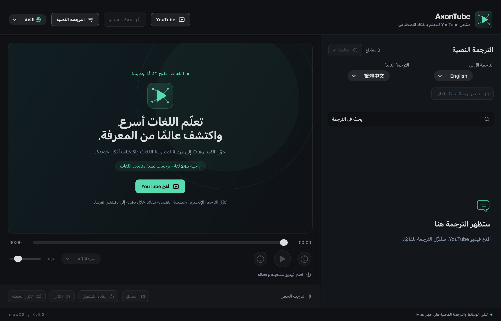

# AxonTube

[English](en.md) · [简体中文](zh-Hans.md) · [繁體中文](zh-Hant.md) · [日本語](ja.md) · [한국어](ko.md) · [Español](es.md) · [Français](fr.md) · [Deutsch](de.md) · [Italiano](it.md) · [Português](pt.md) · [Русский](ru.md) · **العربية** · [हिन्दी](hi.md) · [Türkçe](tr.md) · [Tiếng Việt](vi.md) · [ไทย](th.md) · [Bahasa Indonesia](id.md) · [Nederlands](nl.md) · [Polski](pl.md) · [Українська](uk.md) · [Svenska](sv.md) · [Dansk](da.md) · [Suomi](fi.md) · [עברית](he.md)

[README · English](../../README.md) · [README · 简体中文](../../README.zh-CN.md)

**تعلّم لغات العالم أسرع مع الذكاء الاصطناعي.**

الإصدار 0.5.3 · نسخة تجريبية لنظام macOS · شرائح Apple

[macOS DMG · ZIP · SHA-256](https://github.com/axonvoss-labs/AxonTube/releases/tag/v0.5.3) · [Install / 安装](../INSTALL.md)

حوّل YouTube إلى صفّك الخاص لتعلّم اللغات. استخدم نصوص YouTube المصاحبة للفيديو وترجماته الآلية لتتعلّم من الفيديوهات التي تحبها: اقرأ لغتين جنبًا إلى جنب، وأعد تشغيل كل جملة، واحتفظ بالمحتوى الذي يهمّك.

**24 لغة للواجهة · ترجمات نصية متعددة اللغات**

يشير العدد 24 إلى خيارات لغة الواجهة. تعتمد لغات الترجمة النصية على المسارات المتاحة للفيديو المختار؛ ولا يمثّل ذلك وعدًا بإتقان 24 لغة.

## لقطات الشاشة

التُقطت الصور من التطبيق الفعلي بالإصدار 0.5.3. تُذكر لغة الواجهة في اللقطة بشكل منفصل عن لغة هذا المستند.

### الترحيب ومسار العمل الأساسي

إجراءات شريط الأدوات الأربعة، وقائمتا اختيار الترجمة الظاهرتان، والشعار المترجم، وحالة التعطيل الواضحة قبل فتح فيديو. — لقطة للتطبيق بهذه اللغة

### تدريب يركّز على الجملة

demo.mp4 — البحث عن الجمل، والانتقال بالنقر، والجملة السابقة / التالية، وإعادة التشغيل، والتكرار المستمر، وضبط السرعة، ومتابعة الجملة الحالية. — لقطة للتطبيق بواجهة إنجليزية

### الترجمة الأولى والثانية

لقطة فعلية للواجهة الإنجليزية تُظهر قائمتي الترجمة المستقلتين، بالإنجليزية والصينية التقليدية افتراضيًا. — لقطة للتطبيق بواجهة إنجليزية

### فتح رابط YouTube

لقطة فعلية لنافذة الرابط في الواجهة الإنجليزية. يبدأ فتح الرابط التشغيل ويطلب زوج الترجمات المختار. — لقطة للتطبيق بواجهة إنجليزية

## البدء

### 1. افتح YouTube

الصق رابط فيديو. تُطلب الترجمات النصية المتاحة تلقائيًا، بالإنجليزية للمسار الأول والصينية التقليدية للثاني. قد يستغرق الجلب الأول نحو 1–2 دقيقة؛ ولا يُضمن توفر الترجمات.

### 2. اختر وتدرّب

استخدم قائمتي الترجمة النصية الظاهرتين. انقر على جملة للانتقال إليها، أو أعد تشغيلها، أو فعّل تكرارها المستمر.

### 3. احفظ أو صدّر

يتيح «حفظ الفيديو» اختيار مجلد للوسائط التي يمكن الوصول إليها والترجمات المتاحة. وينشئ «تصدير الترجمات ثنائية اللغة» ملفات Word أو TXT أو SRT من الترجمات المحمّلة.

### 4. اضبطه كما يناسبك

غيّر لغة الواجهة وسرعة التشغيل وحجم الترجمة والإزاحة الزمنية لكل مسار. يتذكّر التطبيق خيارات لغة الواجهة ولغات الترجمة.

## الميزات المتاحة

### مساران مستقلان للترجمة النصية

الافتراضي هو الإنجليزية والصينية التقليدية؛ ويمكنك الاختيار من الترجمات الأصلية والترجمات الآلية المتاحة للفيديو الحالي. يظل المسار الأول صالحًا للاستخدام إذا نجح تحميله وفشل المسار الثاني.

### تدريب يركّز على الجملة

البحث عن الجمل، والانتقال بالنقر، والجملة السابقة / التالية، وإعادة التشغيل، والتكرار المستمر، وضبط السرعة، ومتابعة الجملة الحالية.

### فيديو مع ترجمات متزامنة

يظل الحفظ متاحًا أثناء تحميل الترجمات. تنشئ كل عملية مجلدًا جديدًا يضم الفيديو الذي يمكن الوصول إليه؛ وعند توفر الترجمات، تُضاف مسارات SRT مع توقيتها وملفات قراءة ثنائية اللغة. يمكن أيضًا حفظ الفيديو دون ترجمات. وتبقى النتائج غير المكتملة في مجلد .partial.

### التصدير إلى Word وTXT وSRT

صدّر الترجمات المتاحة بعد تطبيق الإزاحات الزمنية. يقترن النص في Word وTXT وفق تداخل الفترات الزمنية. إذا حُمّل مسار واحد فقط، يظل بالإمكان تصدير محتواه.

### واجهات مترجمة إلى 24 لغة

تتغيّر لغة القوائم ورسائل الحالة وشعار التعلّم معًا. تدعم العربية والعبرية التخطيط من اليمين إلى اليسار؛ ولا يغيّر تبديل لغة الواجهة محتوى الترجمة النصية.

### تشغيل محلي وتحكّم واضح

افتح ملفات الوسائط والترجمة المحلية من قائمة «ملف». تظهر الإجراءات المعطّلة باهتة مع توضيح السبب؛ وتُبرز الأوضاع المختارة بعلامات تحديد؛ ويظهر مؤشر انشغال أثناء الحفظ.

## ما الذي يجعله مفيدًا

### خطوات قليلة من المشاهدة إلى التدريب

أربعة إجراءات في شريط الأدوات تجعل المسار الأساسي مباشرًا: YouTube → حفظ الفيديو → الترجمات → اللغة. لا حاجة إلى زر إضافي لجلب الترجمات.

### مواد تعليمية يمكنك الاحتفاظ بها

تدعم الترجمات المرفقة بتوقيت وملفات Word / TXT سهلة القراءة تدريب الاستماع والمراجعة لاحقًا. تُحفظ الصادرات في وجهات جديدة مع الحفاظ على الملفات الأصلية.

### عمل محلي دون مفتاح API للذكاء الاصطناعي

تعمل الوسائط المحلية والترجمات المحفوظة دون اتصال. يوفّر YouTube ترجمات الموقع والترجمة الآلية؛ ولا يجمع التطبيق بيانات قياس الاستخدام أو يرفع الوسائط المحلية أو يتطلب مفتاح API مدفوعًا للذكاء الاصطناعي.

## المشكلات والقيود القائمة

### P0 · توفر ترجمات YouTube والفيديو

**التحقق من الخدمة المباشرة**

واجه أحدث فحص مباشر شرط YouTube لتسجيل الدخول / التحقق من أن المستخدم ليس روبوتًا. لم يُثبت نجاح التنزيلات عبر الإنترنت في الظروف الحالية. يجب التحقق على الشبكة المقصودة وعلى عينة ممثلة من الفيديوهات قبل الإصدار العام.

### P1 · التضمين والفيديوهات المقيّدة بالحساب

**قيود المنصة**

يمنع بعض الناشرين أو الفيديوهات التشغيل المضمّن. لم يُنفّذ تسجيل الدخول الموحّد Google SSO داخل التطبيق؛ ويستخدم اختصار المتصفح جلسة منفصلة لتسجيل الدخول والتشغيل. لا يجوز عرض هذه القيود على أنها حُلّت.

### P1 · التوقيع والاختبار على أجهزة Mac إضافية

**التوزيع والتوافق**

الحزمة موقّعة بأسلوب ad-hoc، دون توثيق Developer ID. اختُبرت أجهزة Apple Silicon على macOS 26.5.2؛ ولم يُختبر macOS 27 أو أجهزة Mac بمعالجات Intel. macOS 14 هو الحد الأدنى المستهدف للنشر، وليس دليلًا على اختبار كل إصدار.

### P2 · جودة التنزيل ودقة الترجمة النصية

**قيود التنسيق والجودة**

يستخدم الحفظ دفقًا كاملًا يجمع الصوت والفيديو، ولا يدمج تدفقات عالية الدقة منفصلة. يعتمد التشغيل المحلي على دعم برامج الترميز. وقد لا يحتفظ التحويل الاختياري باستخدام FFmpeg بالمسارات الصوتية الإضافية وHDR والترجمات المضمّنة. يستورد ASS/SSA النص فقط. قد تحتوي التسميات التوضيحية التلقائية والترجمات والمطابقة ثنائية اللغة المبنية على التوقيت على أخطاء.

### P2 · سجل التعلّم وأدوات الدراسة

**غير منفّذ**

لم تُنفّذ استعادة سجل التشغيل، أو مجموعات المفردات، أو المراجعة المتباعدة، أو التعرّف البصري على النصوص OCR، أو استخراج الترجمة من الصور. حفظ تفضيلات اللغة لا يعني حفظ تقدّم التعلّم.

### P2 · مراجعة اللغات بواسطة متحدثين أصليين

**المراجعة التحريرية**

اجتازت خيارات الواجهة الـ24 والشعارات المترجمة اختبارات تبديل اللغة. يثبت ذلك التغطية والسلوك، لكنه لا يثبت مراجعة احترافية لكل ترجمة بواسطة متحدث أصلي.

## ما تم التحقق منه

اجتاز الإصدار 0.5.3 ما يلي: 105 فحوص أساسية، و138 اختبار تحقق للنموذج، و29 فحصًا للترجمات، و60 فحصًا لحفظ الفيديو، و317 اختبار تحقق للواجهة الأصلية. اختيرت جميع اللغات الـ24 من القائمة الفعلية؛ ورُوجعت الواجهة بست لغات والتخطيطات الضيقة بالألمانية.

تم التحقق من التشغيل المحلي والتصدير وانتقالات الحالة ونوافذ الحفظ الأصلية. لا تثبت بيانات الاختبار دون اتصال واختبارات الحفظ بأداة مساعدة وهمية أن YouTube يسمح حاليًا بتنزيل الترجمات أو الفيديو عبر الإنترنت. لم تُستورد أي بيانات اعتماد للمستخدمين.

[سجل التحقق التفصيلي](../VERIFICATION.md) · [README · EN](../../README.md) · [README · 简体中文](../../README.zh-CN.md)

[HTML (offline)](../product-guide.html#ar)

التطبيق مرخّص بموجب MIT؛ وتحتفظ مكوّنات الجهات الأخرى بإشعاراتها. لا يتبع AxonTube أيًا من YouTube أو Google أو Apple.

تاريخ المستند: 2026-10-11
