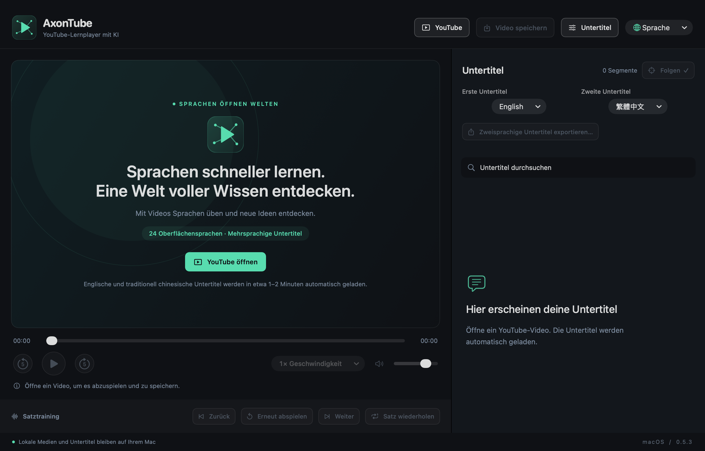

# AxonTube

[English](en.md) · [简体中文](zh-Hans.md) · [繁體中文](zh-Hant.md) · [日本語](ja.md) · [한국어](ko.md) · [Español](es.md) · [Français](fr.md) · **Deutsch** · [Italiano](it.md) · [Português](pt.md) · [Русский](ru.md) · [العربية](ar.md) · [हिन्दी](hi.md) · [Türkçe](tr.md) · [Tiếng Việt](vi.md) · [ไทย](th.md) · [Bahasa Indonesia](id.md) · [Nederlands](nl.md) · [Polski](pl.md) · [Українська](uk.md) · [Svenska](sv.md) · [Dansk](da.md) · [Suomi](fi.md) · [עברית](he.md)

[README · English](../../README.md) · [README · 简体中文](../../README.zh-CN.md)

**Lerne die Sprachen der Welt schneller mit KI.**

Version 0.5.3 · macOS-Vorschau · Apple Silicon

[macOS DMG · ZIP · SHA-256](https://github.com/axonvoss-labs/AxonTube/releases/tag/v0.5.3) · [Install / 安装](../INSTALL.md) · [GitHub Packages](https://github.com/users/axonvoss-labs/packages/container/package/axontube) · [Package guide](../PACKAGES.md)

Mach YouTube zu deinem persönlichen Sprachkurs. Lerne mit YouTube-Untertiteln und automatischen Übersetzungen aus deinen Lieblingsvideos: Lies zwei Sprachen nebeneinander, spiele jeden Satz erneut ab und behalte das Lernmaterial, das dir wichtig ist.

**24 Oberflächensprachen · Mehrsprachige Untertitel**

24 bezeichnet die Anzahl der wählbaren Oberflächensprachen. Die Untertitelsprachen hängen von den verfügbaren Spuren des gewählten Videos ab; fließende Kenntnisse in 24 Sprachen werden damit nicht versprochen.

## Screenshots

Die Screenshots stammen aus der tatsächlichen Anwendung 0.5.3. Die Sprache eines Screenshots wird unabhängig von der Sprache dieses Dokuments angegeben.

### Willkommen und Hauptablauf

Die vier Aktionen der Symbolleiste, zwei sichtbare Untertitelauswahlen, der lokalisierte Slogan und der deutlich erkennbare deaktivierte Zustand vor dem Öffnen eines Videos. — Screenshot der Anwendung in dieser Sprache

### Gezielt Satz für Satz üben

demo.mp4 — Satzsuche, Sprung per Klick, vorheriger / nächster Satz, erneute Wiedergabe, Schleifen, Wiedergabegeschwindigkeit und automatisches Folgen des aktuellen Satzes. — Screenshot der Anwendung auf Englisch

### Erster und zweiter Untertitel

Echte Aufnahme der englischen Oberfläche mit den unabhängigen Untertitelmenüs, standardmäßig auf Englisch und traditionelles Chinesisch eingestellt. — Screenshot der Anwendung auf Englisch

### Einen YouTube-Link öffnen

Echte Aufnahme des Linkdialogs in der englischen Oberfläche. Das Öffnen eines Links startet die Wiedergabe und fordert die beiden gewählten Untertitelspuren an. — Screenshot der Anwendung auf Englisch

## Erste Schritte

### 1. YouTube öffnen

Füge einen Videolink ein. Verfügbare Untertitel werden automatisch angefordert, standardmäßig Englisch als erste und traditionelles Chinesisch als zweite Spur. Der erste Abruf kann etwa 1–2 Minuten dauern; die Verfügbarkeit ist nicht garantiert.

### 2. Auswählen und üben

Nutze die beiden sichtbaren Untertitelmenüs. Klicke auf einen Satz, um dorthin zu springen, ihn erneut abzuspielen oder die Satzschleife zu aktivieren.

### 3. Speichern oder exportieren

Mit „Video speichern“ wählst du einen Ordner für zugängliche Medien und verfügbare Untertitel. „Zweisprachige Untertitel exportieren“ erstellt Word-, TXT- oder SRT-Dateien aus den geladenen Untertiteln.

### 4. An deine Bedürfnisse anpassen

Ändere Oberflächensprache, Wiedergabegeschwindigkeit, Untertitelgröße und den Zeitversatz jeder Spur. Die App merkt sich die gewählten Oberflächen- und Untertitelsprachen.

## Verfügbare Funktionen

### Zwei unabhängige Untertitelspuren

Standardmäßig Englisch / traditionelles Chinesisch; wähle aus den verfügbaren Originalen und automatischen Übersetzungen des aktuellen Videos. Erfolgreich geladene Untertitel der ersten Spur bleiben nutzbar, wenn die zweite Spur fehlschlägt.

### Gezielt Satz für Satz üben

Satzsuche, Sprung per Klick, vorheriger / nächster Satz, erneute Wiedergabe, Schleifen, Wiedergabegeschwindigkeit und automatisches Folgen des aktuellen Satzes.

### Video mit synchronisierten Untertiteln

Speichern bleibt möglich, während Untertitel geladen werden. Jeder Vorgang erstellt einen neuen Ordner für das zugängliche Video und fügt bei verfügbaren Untertiteln SRT-Spuren mit Zeitangaben sowie zweisprachige Lesedateien hinzu. Auch das Video allein kann gespeichert werden; unvollständige Vorgänge verbleiben in einem .partial-Ordner.

### Export als Word, TXT und SRT

Exportiere verfügbare Untertitel mit angewendetem Zeitversatz. Word und TXT ordnen die Texte anhand zeitlicher Überschneidungen einander zu. Wenn nur eine Spur geladen ist, lässt sich deren Inhalt ebenfalls exportieren.

### 24 lokalisierte Oberflächen

Menüs, Statusmeldungen und der Lernslogan wechseln gemeinsam die Sprache. Arabisch und Hebräisch unterstützen Layouts von rechts nach links; ein Wechsel der Oberflächensprache verändert die Untertitelinhalte nicht.

### Lokale Wiedergabe und klare Bedienelemente

Öffne lokale Medien- und Untertiteldateien über das Menü „Datei“. Nicht verfügbare Aktionen sind mit Begründung ausgegraut; gewählte Modi werden hervorgehoben und mit Häkchen markiert; beim Speichern erscheint ein Beschäftigtstatus.

## Was die App nützlich macht

### In wenigen Schritten vom Anschauen zum Üben

Vier Aktionen in der Symbolleiste machen den Hauptablauf übersichtlich: YouTube → Video speichern → Untertitel → Sprache. Zum Abrufen der Untertitel ist keine zusätzliche Schaltfläche nötig.

### Lernmaterial zum Behalten

Untertitel mit Zeitangaben und gut lesbare Word- / TXT-Dateien eignen sich zum Hörtraining und zum späteren Wiederholen. Exporte verwenden neue Speicherziele und erhalten die Originaldateien.

### Lokal arbeiten, ohne KI-API-Schlüssel

Lokale Medien und gespeicherte Untertitel funktionieren offline. YouTube stellt die Website-Untertitel und automatischen Übersetzungen bereit; die App hat keine Telemetrie, lädt keine lokalen Medien hoch und benötigt keinen kostenpflichtigen KI-API-Schlüssel.

## Offene Punkte und Grenzen

### P0 · Verfügbarkeit von YouTube-Untertiteln und -Videos

**Prüfung des Live-Dienstes**

Die letzte Online-Prüfung stieß auf YouTubes Anforderung zur Anmeldung / Bot-Verifizierung. Erfolgreiche aktuelle Online-Downloads sind nicht belegt. Vor einer Veröffentlichung muss die Funktion im vorgesehenen Netzwerk und mit repräsentativen Videos geprüft werden.

### P1 · Videos mit Einbettungs- und Kontobeschränkungen

**Plattformbeschränkung**

Manche Urheber oder Videos erlauben keine eingebettete Wiedergabe. Google SSO innerhalb der App ist nicht implementiert; der Browser-Shortcut verwendet eine separate Anmelde- und Wiedergabesitzung. Diese Einschränkungen dürfen nicht als gelöst dargestellt werden.

### P1 · Signierung und Tests auf weiteren Macs

**Verteilung und Kompatibilität**

Das Paket ist ad hoc signiert, ohne Developer-ID-Notarisierung. Getestet wurde Apple Silicon mit macOS 26.5.2; macOS 27 und Intel-Macs wurden nicht getestet. macOS 14 ist das Deployment-Ziel, kein Nachweis dafür, dass jede Version geprüft wurde.

### P2 · Downloadqualität und Untertiteltreue

**Format- und Qualitätsgrenzen**

Zum Speichern wird ein vollständiger Audio-/Videostream verwendet; separate hochauflösende Streams werden nicht zusammengeführt. Aus ASS/SSA wird nur Text importiert. Automatische Untertitel, Übersetzungen und die zeitbasierte zweisprachige Zuordnung können Fehler enthalten. Lokale Wiedergabe hängt von der Codec-Unterstützung ab. Bei der optionalen FFmpeg-Konvertierung können zusätzliche Audiospuren, HDR und eingebettete Untertitel entfallen.

### P2 · Lernverlauf und Lernwerkzeuge

**Nicht implementiert**

Das Wiederherstellen des Wiedergabeverlaufs, Vokabelsammlungen, zeitlich gestaffeltes Wiederholen, OCR und das Extrahieren von Bilduntertiteln sind nicht implementiert. Gespeicherte Spracheinstellungen sind kein gespeicherter Lernfortschritt.

### P2 · Sprachprüfung durch Muttersprachler

**Redaktionelle Prüfung**

Alle 24 Oberflächensprachen und lokalisierten Slogans haben die Umschaltprüfungen bestanden. Das bestätigt Abdeckung und Verhalten, aber keine professionelle muttersprachliche Prüfung jeder Übersetzung.

## Was überprüft wurde

Für 0.5.3 bestanden: 105 Kernprüfungen, 138 Modell-Assertions, 29 Untertitelprüfungen, 60 Prüfungen zum Videospeichern und 317 Assertions der nativen Oberfläche. Alle 24 Sprachen wurden im tatsächlichen Menü ausgewählt; sechs Oberflächensprachen und kompakte deutsche Layouts wurden geprüft.

Lokale Wiedergabe, Exporte, Zustandswechsel und native Speicherdialoge wurden überprüft. Offline-Testdaten und Speichertests mit einem simulierten Hilfsprogramm belegen nicht, dass YouTube derzeit Online-Downloads von Untertiteln oder Videos erlaubt. Es wurden keine Benutzeranmeldedaten importiert.

[Ausführlicher Prüfbericht](../VERIFICATION.md) · [README · EN](../../README.md) · [README · 简体中文](../../README.zh-CN.md)

[HTML (offline)](../product-guide.html#de)

Die Anwendung steht unter der MIT-Lizenz; die Hinweise zu Komponenten Dritter bleiben erhalten. AxonTube ist nicht mit YouTube, Google oder Apple verbunden.

Dokumentdatum: 2026-10-11
