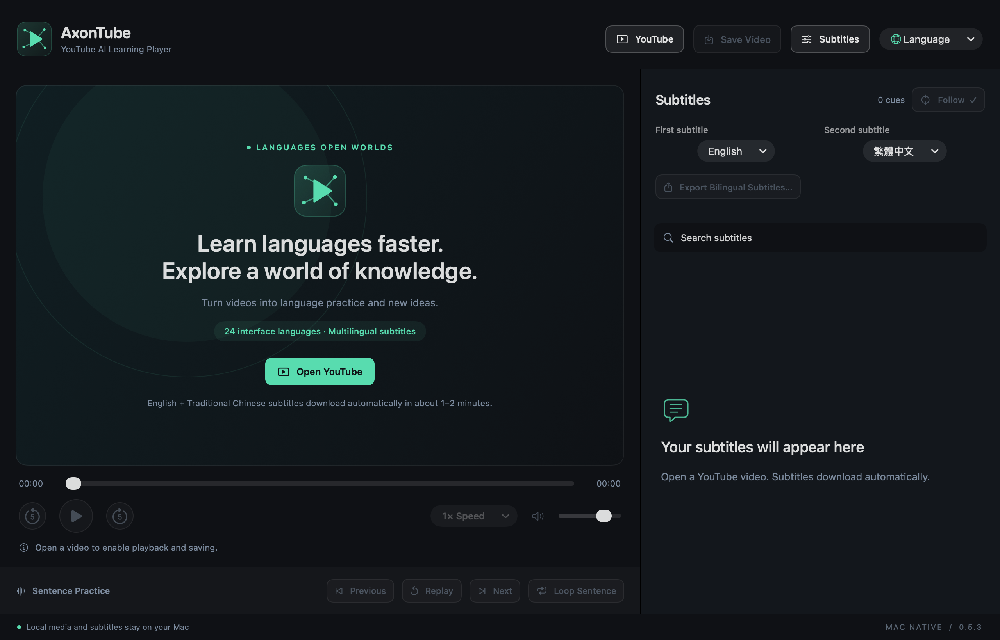
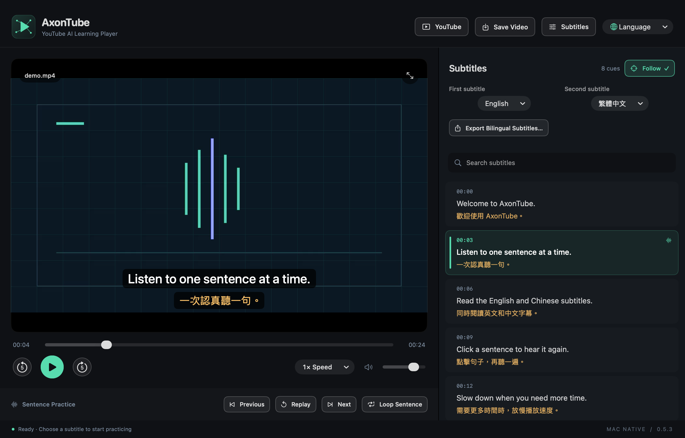
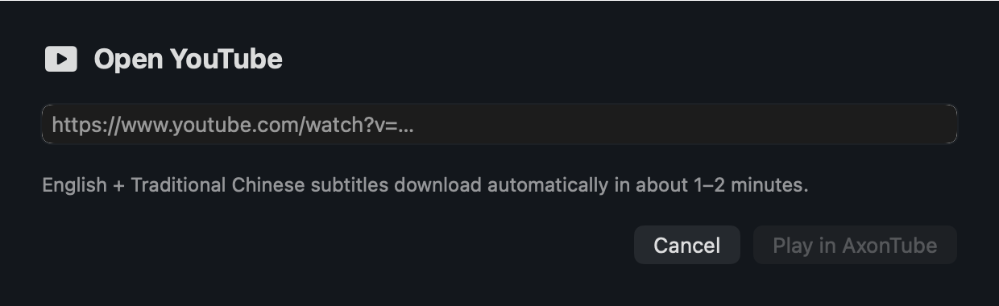

# AxonTube

**English** · [简体中文](zh-Hans.md) · [繁體中文](zh-Hant.md) · [日本語](ja.md) · [한국어](ko.md) · [Español](es.md) · [Français](fr.md) · [Deutsch](de.md) · [Italiano](it.md) · [Português](pt.md) · [Русский](ru.md) · [العربية](ar.md) · [हिन्दी](hi.md) · [Türkçe](tr.md) · [Tiếng Việt](vi.md) · [ไทย](th.md) · [Bahasa Indonesia](id.md) · [Nederlands](nl.md) · [Polski](pl.md) · [Українська](uk.md) · [Svenska](sv.md) · [Dansk](da.md) · [Suomi](fi.md) · [עברית](he.md)

[README · English](../../README.md) · [README · 简体中文](../../README.zh-CN.md)

**Learn the World's Languages Faster with AI.**

Version 0.5.3 · macOS preview · Apple silicon

[macOS DMG · ZIP · SHA-256](https://github.com/axonvoss-labs/AxonTube/releases/tag/v0.5.3) · [Install / 安装](../INSTALL.md) · [GitHub Packages](https://github.com/users/axonvoss-labs/packages/container/package/axontube) · [Package guide](../PACKAGES.md)

Turn YouTube into your personal language classroom. Use YouTube captions and automatic translations to learn from videos you love: read two languages side by side, replay each sentence, and keep the material that matters.

**24 interface languages · Multilingual subtitles**

24 counts interface choices. Subtitle languages depend on the selected video's available tracks; it is not a promise of fluency in 24 languages.

## Screenshots

Screenshots are captured from the actual 0.5.3 application. The screenshot's language is labeled separately from this document's language.

### Welcome and main workflow

The four toolbar actions, two visible subtitle selectors, localized slogan, and clear disabled state before a video is opened. — Application screenshot in this language

### Sentence-focused practice

demo.mp4 — Sentence search, click-to-seek, previous / next, replay, looping, playback speed, and following the current sentence. — English application screenshot

### First and second subtitle

Actual English-interface capture of the independent subtitle dropdowns, defaulting to English and Traditional Chinese. — English application screenshot

### Open a YouTube link

Actual English-interface capture of the link dialog. Opening a link starts playback and requests the selected caption pair. — English application screenshot

## Getting started

### 1. Open YouTube

Paste a video link. Available captions are requested automatically, with English first and Traditional Chinese second. Initial retrieval may take about 1–2 minutes; availability is not guaranteed.

### 2. Choose and practise

Use the two visible subtitle dropdowns. Click a sentence to jump to it, replay it, or enable a sentence loop.

### 3. Save or export

Save Video chooses a folder for accessible media and available subtitles. Export Bilingual Subtitles creates Word, TXT, or SRT from loaded captions.

### 4. Make it yours

Change interface language, playback speed, subtitle size, and each track's timing offset. The app remembers interface and subtitle-language choices.

## Available features

### Two independent subtitle tracks

English / Traditional Chinese defaults; choose from the current video's available originals and automatic translations. Successful first-track captions remain usable if the second track fails.

### Sentence-focused practice

Sentence search, click-to-seek, previous / next, replay, looping, playback speed, and following the current sentence.

### Video with synchronized subtitles

Saving stays available while captions load. Each operation creates a new folder for accessible video; timed SRT tracks and bilingual reading files are added when captions are available. Video-only saving is supported. Incomplete work stays in a .partial folder.

### Word, TXT, and SRT export

Export available subtitles with timing offsets applied. Word and TXT pair text by time overlap. If only one track is loaded, its content can still be exported.

### 24 localized interfaces

Menus, status messages, and the learning slogan switch languages together. Arabic and Hebrew support right-to-left layouts; subtitle content is not changed by switching the interface.

### Local playback and clear controls

Open local media and subtitle files from the File menu. Disabled actions are dimmed with reasons; selected modes have highlights and checkmarks; saving shows a busy state.

## Why it is useful

### A short path from watching to practising

Four toolbar actions keep the main flow direct: YouTube → Save Video → Subtitles → Language. No extra caption-fetch button is needed.

### Learning material you can keep

Timed captions and readable Word / TXT files support both listening practice and later review. Exports use new destinations and preserve original files.

### Local work, no AI API key

Local media and saved subtitles work offline. YouTube supplies website captions and automatic translations; the app has no telemetry and does not upload local media or require a paid AI API key.

## Open issues and limits

### P0 · YouTube caption and video availability

**Live-service verification**

The latest live check hit YouTube's sign-in / bot-verification requirement. Successful current online downloads have not been established. Validate under the intended network and across representative videos before public release.

### P1 · Embedding and account-restricted videos

**Platform restriction**

Some authors or videos disallow embedded playback. In-app Google SSO is not implemented; the browser shortcut uses a separate login and playback session. These restrictions cannot be presented as solved.

### P1 · Signing and broader Mac testing

**Distribution and compatibility**

The package is ad-hoc signed, without Developer ID notarization. Apple Silicon on macOS 26.5.2 was tested; macOS 27 and Intel Macs were not. macOS 14 is a deployment target, not proof that every version has been tested.

### P2 · Download quality and subtitle fidelity

**Format and quality limits**

Saving uses a complete audio/video stream and does not merge separate high-resolution streams. ASS/SSA imports text only. Automatic captions, translations, and timing-based bilingual pairing may contain errors. Local playback depends on codec support; optional FFmpeg conversion may omit extra audio tracks, HDR, and embedded subtitles.

### P2 · Learning-history and study tools

**Not implemented**

Playback-history restoration, vocabulary collections, spaced review, OCR, and image-subtitle extraction are not implemented. Saved language preferences are not saved learning progress.

### P2 · Native-speaker language review

**Editorial review**

All 24 interface choices and localized slogans passed switching checks. That establishes coverage and behavior, not professional native-speaker review of every translation.

## What has been verified

For 0.5.3: 105 core checks, 138 model assertions, 29 caption checks, 60 video-save checks, and 317 native-interface assertions passed. All 24 language choices were selected in the actual menu; six interface languages and compact German layouts were reviewed.

Local playback, exports, state transitions, and native save dialogs were verified. Offline fixtures and fake-helper save tests do not prove that YouTube currently permits online caption or video downloads. No user credentials were imported.

[Detailed verification record](../VERIFICATION.md) · [README · EN](../../README.md) · [README · 简体中文](../../README.zh-CN.md)

[HTML (offline)](../product-guide.html#en)

MIT application license; third-party components retain their notices. AxonTube is not affiliated with YouTube, Google, or Apple.

Document date: 2026-10-11
