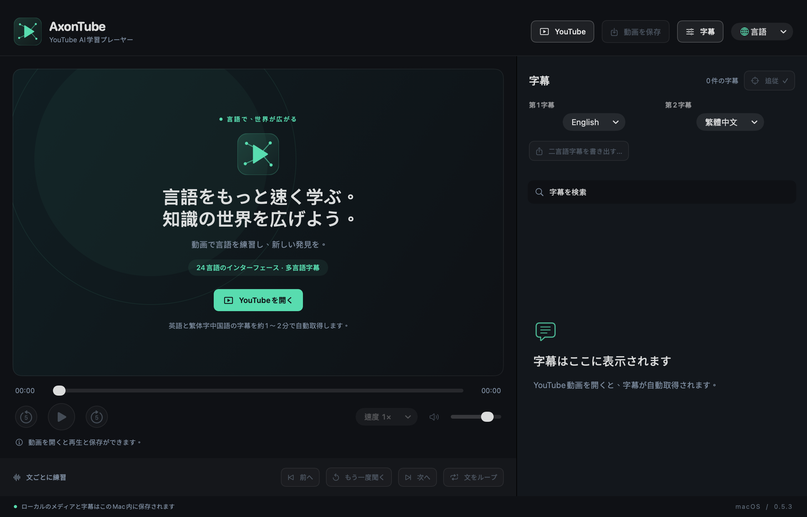

# AxonTube

[English](en.md) · [简体中文](zh-Hans.md) · [繁體中文](zh-Hant.md) · **日本語** · [한국어](ko.md) · [Español](es.md) · [Français](fr.md) · [Deutsch](de.md) · [Italiano](it.md) · [Português](pt.md) · [Русский](ru.md) · [العربية](ar.md) · [हिन्दी](hi.md) · [Türkçe](tr.md) · [Tiếng Việt](vi.md) · [ไทย](th.md) · [Bahasa Indonesia](id.md) · [Nederlands](nl.md) · [Polski](pl.md) · [Українська](uk.md) · [Svenska](sv.md) · [Dansk](da.md) · [Suomi](fi.md) · [עברית](he.md)

[README · English](../../README.md) · [README · 简体中文](../../README.zh-CN.md)

**AIで、世界の言語をもっと速く学ぼう。**

バージョン 0.5.3 · macOS プレビュー版 · Apple シリコン

[macOS DMG · ZIP · SHA-256](https://github.com/axonvoss-labs/AxonTube/releases/tag/v0.5.3) · [Install / 安装](../INSTALL.md) · [GitHub Packages](https://github.com/users/axonvoss-labs/packages/container/package/axontube) · [Package guide](../PACKAGES.md)

YouTubeを、あなた専用の語学教室に。YouTubeの字幕と自動翻訳を使って、好きな動画で学びましょう。2つの言語を並べて読み、一文ずつ繰り返し再生し、大切な学習素材を手元に残せます。

**24 の表示言語 · 多言語字幕**

24 は画面の表示言語の選択肢数です。字幕の言語は選択した動画で利用できるトラックによって異なり、24 言語の習得を保証するものではありません。

## スクリーンショット

スクリーンショットは実際の 0.5.3 アプリで撮影しています。画面の表示言語は、このガイドの言語とは別に記載しています。

### ようこそ画面と基本の操作

動画を開く前の、ツールバーの 4 つの操作、画面上の 2 つの字幕選択メニュー、各言語のスローガン、明確な無効状態です。 — この言語で表示したアプリ画面

### 文ごとに集中して練習

demo.mp4 — 文の検索、クリックでの再生位置移動、前後の文への移動、再再生、ループ、再生速度の調整、現在の文への追従に対応しています。 — 英語表示のアプリ画面

### 第 1 字幕と第 2 字幕

英語表示の実際の画面です。独立した 2 つの字幕メニューの初期設定は、英語と繁体字中国語です。 — 英語表示のアプリ画面

### YouTube のリンクを開く

英語表示のリンク入力ダイアログの実際の画面です。リンクを開くと再生が始まり、選択した 2 つの字幕を取得します。 — 英語表示のアプリ画面

## 使い始める

### 1. YouTube を開く

動画のリンクを貼り付けます。利用可能な字幕を自動で取得し、初期設定では第 1 字幕が英語、第 2 字幕が繁体字中国語です。初回の取得には約 1〜2 分かかる場合があり、必ず取得できるとは限りません。

### 2. 選んで練習する

画面上の 2 つの字幕メニューを使います。文をクリックしてその位置に移動し、再生し直したり、文のループ再生を有効にしたりできます。

### 3. 保存・書き出し

「動画を保存」では、取得可能な動画と利用可能な字幕の保存先フォルダを選びます。「対訳字幕を書き出す」では、読み込み済みの字幕から Word、TXT、SRT を作成します。

### 4. 自分に合わせる

表示言語、再生速度、字幕サイズ、各トラックのタイミング補正を変更できます。表示言語と字幕言語の選択はアプリに保存されます。

## 利用できる機能

### 独立した 2 つの字幕トラック

初期設定は英語 / 繁体字中国語です。現在の動画で利用できる元の字幕と自動翻訳から選択できます。第 2 字幕の取得に失敗しても、取得済みの第 1 字幕は引き続き使えます。

### 文ごとに集中して練習

文の検索、クリックでの再生位置移動、前後の文への移動、再再生、ループ、再生速度の調整、現在の文への追従に対応しています。

### 動画と同期字幕をまとめて保存

字幕の読み込み中も保存できます。保存のたびに取得可能な動画用の新しいフォルダを作成し、字幕が利用できる場合は時刻付き SRT トラックと対訳の読み物ファイルも格納します。字幕なしで動画だけを保存することもできます。未完了の処理は .partial フォルダに残ります。

### Word・TXT・SRT への書き出し

タイミング補正を適用して利用可能な字幕を書き出します。Word と TXT は時間の重なりに基づいて対訳を組み合わせます。読み込まれているトラックが 1 つだけでも、その内容を書き出せます。

### 24 言語のインターフェース

メニュー、状態メッセージ、学習スローガンの言語が一緒に切り替わります。アラビア語とヘブライ語は右から左へのレイアウトに対応しています。表示言語を変えても字幕の内容は変わりません。

### ローカル再生と分かりやすい操作

「ファイル」メニューからローカルの動画・音声や字幕ファイルを開けます。使えない操作は理由付きで淡く表示され、選択中のモードは強調表示とチェックマークで示されます。保存中は処理中の状態を表示します。

## 学習に役立つポイント

### 視聴から練習へ、少ない手順で

ツールバーの 4 つの操作で主要な流れを進められます: YouTube → 動画を保存 → 字幕 → 言語。字幕を取得するための追加ボタンは不要です。

### 手元に残せる学習教材

時刻付き字幕と読みやすい Word / TXT ファイルは、聞き取り練習にも後からの復習にも使えます。書き出しには新しい保存先を使い、元のファイルを保持します。

### ローカルで使える、AI API キー不要

ローカルのメディアと保存済み字幕はオフラインで使えます。Web サイトの字幕と自動翻訳は YouTube が提供します。アプリはテレメトリを収集せず、ローカルのメディアをアップロードせず、有料 AI API のキーも必要ありません。

## 未解決の課題と制限

### P0 · YouTube の字幕・動画の取得可否

**ライブサービスの検証**

直近のオンライン検証では、YouTube によるログイン / ボット確認の要求により取得できませんでした。現在のオンラインダウンロードの成功は確認できていません。公開前に、想定するネットワーク環境と代表的な複数の動画で検証する必要があります。

### P1 · 埋め込みとアカウント制限のある動画

**プラットフォームの制限**

投稿者や動画によっては埋め込み再生が許可されていません。アプリ内の Google SSO は未実装です。ブラウザを開くショートカットでは、ログインと再生のセッションは別になります。これらの制限が解消済みであるとは案内できません。

### P1 · 署名とより広い Mac 環境での検証

**配布と互換性**

パッケージはアドホック署名で、Developer ID による署名・公証はありません。macOS 26.5.2 の Apple Silicon で検証済みです。macOS 27 と Intel Mac は未検証です。macOS 14 はデプロイ対象の最小バージョンであり、すべてのバージョンを検証した証拠ではありません。

### P2 · ダウンロード品質と字幕の再現性

**形式と品質の制限**

保存には音声と映像が一体のストリームを使い、別々の高解像度ストリームの結合は行いません。ASS/SSA の読み込みはテキストのみです。自動字幕、翻訳、時間に基づく対訳の組み合わせには誤りが含まれる場合があります。 ローカル再生はコーデックの対応状況に依存します。オプションの FFmpeg 変換では、追加の音声トラック、HDR、埋め込み字幕が保持されない場合があります。

### P2 · 学習履歴と学習支援ツール

**未実装**

再生履歴の復元、単語帳、間隔を空けた復習、OCR、画像字幕の抽出は未実装です。言語設定の保存は、学習進捗の保存ではありません。

### P2 · ネイティブ話者による言語レビュー

**文章のレビュー**

24 の表示言語と各言語のスローガンは、すべて切り替え検証に合格しました。これは対応範囲と動作を確認するもので、すべての翻訳を専門のネイティブ話者が確認したことを意味しません。

## 検証済みの内容

0.5.3 では、コア検証 105 件、モデルのアサーション 138 件、字幕検証 29 件、動画保存の検証 60 件、ネイティブ UI のアサーション 317 件が合格しました。実際のメニューで 24 の表示言語すべてを選択し、6 言語の画面とドイツ語のコンパクトレイアウトを確認しました。

ローカル再生、書き出し、状態遷移、ネイティブの保存ダイアログを検証しました。オフラインのテストデータと模擬ヘルパーによる保存テストは、YouTube が現在オンラインでの字幕や動画のダウンロードを許可している証拠にはなりません。ユーザーの認証情報は取り込んでいません。

[詳しい検証記録](../VERIFICATION.md) · [README · EN](../../README.md) · [README · 简体中文](../../README.zh-CN.md)

[HTML (offline)](../product-guide.html#ja)

アプリのライセンスは MIT です。第三者製コンポーネントの告知は保持しています。AxonTube は YouTube、Google、Apple と提携していません。

文書の日付: 2026-10-11
