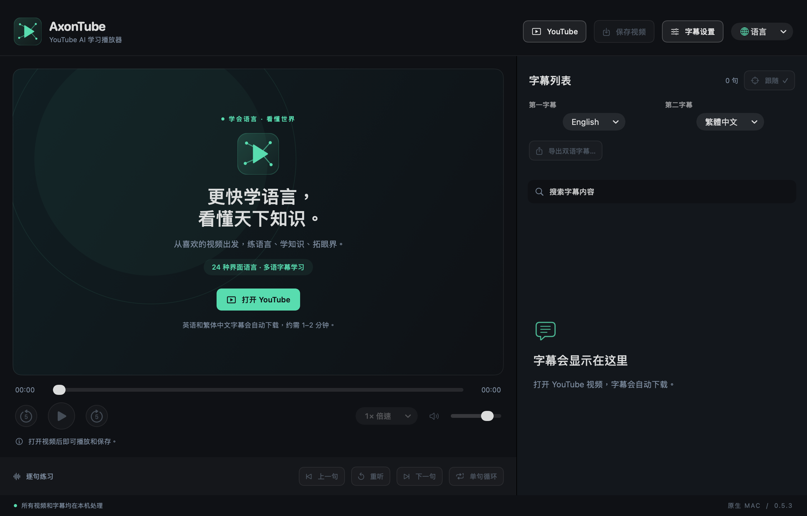

# AxonTube

[English](en.md) · **简体中文** · [繁體中文](zh-Hant.md) · [日本語](ja.md) · [한국어](ko.md) · [Español](es.md) · [Français](fr.md) · [Deutsch](de.md) · [Italiano](it.md) · [Português](pt.md) · [Русский](ru.md) · [العربية](ar.md) · [हिन्दी](hi.md) · [Türkçe](tr.md) · [Tiếng Việt](vi.md) · [ไทย](th.md) · [Bahasa Indonesia](id.md) · [Nederlands](nl.md) · [Polski](pl.md) · [Українська](uk.md) · [Svenska](sv.md) · [Dansk](da.md) · [Suomi](fi.md) · [עברית](he.md)

[README · English](../../README.md) · [README · 简体中文](../../README.zh-CN.md)

**用 AI，更快掌握世界语言。**

0.5.3 版本 · 源码预览版 · 请从源码构建

把 YouTube 变成你的私人语言课堂。从热爱的视频出发，借助 YouTube 字幕和自动翻译，双语对照、逐句重听，把感兴趣的内容变成可以反复学习的材料。

**24 种界面语言 · 多语字幕学习**

24 种指界面语言选项。字幕语言以当前视频实际提供的轨道为准，不代表保证掌握 24 种语言。

## 页面截图

截图来自实际运行的 0.5.3 应用。每张图会单独标注截图语言，不把文档翻译当成已经存在的界面截图。

### 欢迎页与主要入口

展示四个顶部入口、常驻的两个字幕选择框、本地化标语，以及未打开视频时的明确禁用状态。 — 当前语言的应用截图

### 围绕句子的听读练习

demo.mp4 — 支持字幕搜索、点句跳转、上一句／下一句、重听、循环、倍速，以及跟随当前句滚动。 — 英语界面截图

### 第一字幕与第二字幕

英语界面的实际截图：两轨语言可独立选择，默认分别是英语和繁体中文。 — 英语界面截图

### 打开 YouTube 链接

英语界面的链接输入窗口实际截图。打开链接后开始播放，并请求当前选择的两条字幕。 — 英语界面截图

## 快速开始

### 1. 打开 YouTube

粘贴视频链接，自动请求可用字幕，默认第一字幕英语、第二字幕繁体中文。首次获取可能需要约 1–2 分钟，实际可用性取决于视频和服务状态。

### 2. 选择语言并练习

通过常驻的两个字幕下拉框选择语言。点击句子可跳转、重听，也可以开启单句循环。

### 3. 保存或导出

“保存视频”将可下载的媒体和可用字幕存入指定目录；“导出双语字幕”把已经载入的字幕保存为 Word、TXT 或 SRT。

### 4. 调整学习方式

切换界面语言、倍速、字幕字号和两轨各自的时间偏移。应用会记住界面语言与字幕语言选择。

## 已有功能

### 两条独立字幕轨道

默认英语／繁体中文，可选择当前视频提供的原语字幕或自动译文。第二轨失败时，已获取的第一轨仍可阅读和导出。

### 围绕句子的听读练习

支持字幕搜索、点句跳转、上一句／下一句、重听、循环、倍速，以及跟随当前句滚动。

### 保存视频与同步字幕

字幕仍在获取时也能开始保存。每次建立新目录，写入可下载的视频；有可用字幕时，另存带时间轴的 SRT 与双语阅读文件。支持只保存视频，未完成内容保留在 .partial 目录中。

### 导出 Word、TXT、SRT

按当前字幕与时间偏移导出。Word 和 TXT 按时间重叠配对双语内容；只有一条字幕时也能导出。

### 24 种本地化界面

菜单、状态提示和学习标语随语言一起切换，阿拉伯语和希伯来语支持从右向左排版。切换界面不会改写字幕内容。

### 本地播放与明确的按钮状态

可从“文件”菜单打开本地媒体和字幕。不可用按钮灰显并说明原因，已选模式高亮加勾，保存过程显示忙碌状态。

## 产品亮点

### 从观看到练习，步骤直接

顶部四个入口依次为 YouTube → 保存视频 → 字幕设置 → 语言。打开链接后自动取字幕，无须再点击额外的获取按钮。

### 学习资料可以留下来

时间轴字幕用于听力练习，Word／TXT 便于阅读和复习。导出使用新目标位置，保留原始文件。

### 本地处理，无需 AI API 密钥

本地媒体和已保存字幕可离线使用。网站字幕与自动翻译由 YouTube 提供；应用不设置遥测，不上传本地媒体，也不需要付费 AI API 密钥。

## 待解决问题与当前限制

### P0 · YouTube 字幕与视频的实际可用性

**在线验证缺口**

最近一次在线检查遇到 YouTube 登录／机器人验证，尚未证实当前环境下能成功下载在线字幕或视频。公开发布前，需要在实际使用网络和不同代表性视频上验证。

### P1 · 嵌入播放和账号限制

**平台限制**

部分作者或视频不允许嵌入播放。尚无应用内 Google SSO；浏览器入口使用独立的登录与播放会话。这些限制不能视为已经解决。

### P1 · 正式签名及更多 Mac 测试

**发布与兼容性**

安装包目前为 ad-hoc 签名，未做 Developer ID 公证。已测试 Apple Silicon、macOS 26.5.2；macOS 27 和 Intel Mac 尚未实测。macOS 14 是部署目标，不代表每个版本都已验证。

### P2 · 下载画质与字幕准确性

**格式与质量限制**

保存选用完整音视频流，不合并独立的高分辨率视频与音频流。ASS／SSA 只导入文字。自动字幕、译文以及按时间配对的双语内容均可能有误差。本地播放取决于编解码器支持；可选 FFmpeg 转换可能无法保留额外音轨、HDR 和内嵌字幕。

### P2 · 学习记录与进阶学习工具

**尚未实现**

播放历史恢复、生词本、间隔复习、OCR 与图片字幕提取尚未实现。记住语言偏好不等于保存了学习进度。

### P2 · 各语言的母语级校对

**语言审校**

24 种界面与宣传语已经通过切换检查，这证明了覆盖和交互正常，不等于全部译文均经过专业母语审校。

## 已经验证了什么

0.5.3 已通过 105 项核心检查、138 项模型断言、29 项字幕检查、60 项视频保存检查及 317 项原生界面断言。实际点击了全部 24 个语言选项，并检查了六种语言界面与德文紧凑窗口。

已验证本地播放、导出、状态切换和原生保存目录弹窗。离线样本和模拟下载工具测试，不能证明 YouTube 当前允许在线字幕或视频下载。测试没有导入用户登录凭据。

[完整验证记录](../VERIFICATION.md) · [README · EN](../../README.md) · [README · 简体中文](../../README.zh-CN.md)

[HTML (offline)](../product-guide.html#zh-Hans)

应用采用 MIT 许可，第三方组件保留原许可与声明。AxonTube 与 YouTube、Google、Apple 无隶属关系。

文档日期：2026-10-11
