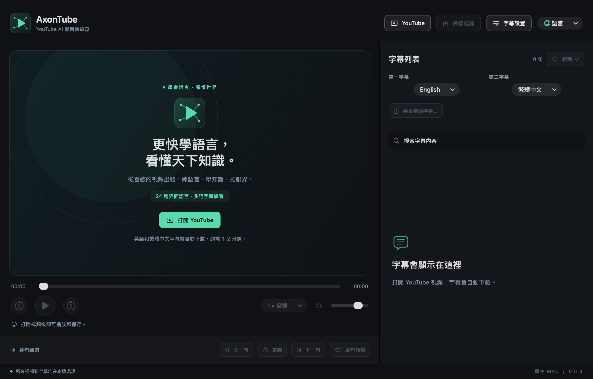

# AxonTube

[English](en.md) · [简体中文](zh-Hans.md) · **繁體中文** · [日本語](ja.md) · [한국어](ko.md) · [Español](es.md) · [Français](fr.md) · [Deutsch](de.md) · [Italiano](it.md) · [Português](pt.md) · [Русский](ru.md) · [العربية](ar.md) · [हिन्दी](hi.md) · [Türkçe](tr.md) · [Tiếng Việt](vi.md) · [ไทย](th.md) · [Bahasa Indonesia](id.md) · [Nederlands](nl.md) · [Polski](pl.md) · [Українська](uk.md) · [Svenska](sv.md) · [Dansk](da.md) · [Suomi](fi.md) · [עברית](he.md)

[README · English](../../README.md) · [README · 简体中文](../../README.zh-CN.md)

**用 AI，更快掌握世界語言。**

0.5.3 版本 · 源碼預覽版 · 請從源碼構建

把 YouTube 變成你的私人語言課堂。從熱愛的視頻出發，借助 YouTube 字幕和自動翻譯，雙語對照、逐句重聽，把感興趣的內容變成可以反復學習的材料。

**24 種界面語言 · 多語字幕學習**

24 種指界面語言選項。字幕語言以當前視頻實際提供的軌道為準，不代表保證掌握 24 種語言。

## 頁面截圖

截圖來自實際運行的 0.5.3 應用。每張圖會單獨標注截圖語言，不把文檔翻譯當成已經存在的界面截圖。

### 歡迎頁與主要入口

展示四個頂部入口、常駐的兩個字幕選擇框、本地化標語，以及未打開視頻時的明確禁用狀態。 — 當前語言的應用截圖

### 圍繞句子的聽讀練習

demo.mp4 — 支持字幕搜索、點句跳轉、上一句／下一句、重聽、循環、倍速，以及跟隨當前句滾動。 — 英語界面截圖

### 第一字幕與第二字幕

英語界面的實際截圖：兩軌語言可獨立選擇，默認分別是英語和繁體中文。 — 英語界面截圖

### 打開 YouTube 鏈接

英語界面的鏈接輸入窗口實際截圖。打開鏈接後開始播放，並請求當前選擇的兩條字幕。 — 英語界面截圖

## 快速開始

### 1. 打開 YouTube

粘貼視頻鏈接，自動請求可用字幕，默認第一字幕英語、第二字幕繁體中文。首次獲取可能需要約 1–2 分鐘，實際可用性取決於視頻和服務狀態。

### 2. 選擇語言並練習

通過常駐的兩個字幕下拉框選擇語言。點擊句子可跳轉、重聽，也可以開啓單句循環。

### 3. 保存或導出

“保存視頻”將可下載的媒體和可用字幕存入指定目錄；“導出雙語字幕”把已經載入的字幕保存為 Word、TXT 或 SRT。

### 4. 調整學習方式

切換界面語言、倍速、字幕字號和兩軌各自的時間偏移。應用會記住界面語言與字幕語言選擇。

## 已有功能

### 兩條獨立字幕軌道

默認英語／繁體中文，可選擇當前視頻提供的原語字幕或自動譯文。第二軌失敗時，已獲取的第一軌仍可閱讀和導出。

### 圍繞句子的聽讀練習

支持字幕搜索、點句跳轉、上一句／下一句、重聽、循環、倍速，以及跟隨當前句滾動。

### 保存視頻與同步字幕

字幕仍在獲取時也能開始保存。每次建立新目錄，寫入可下載的視頻；有可用字幕時，另存帶時間軸的 SRT 與雙語閱讀文件。支持只保存視頻，未完成內容保留在 .partial 目錄中。

### 導出 Word、TXT、SRT

按當前字幕與時間偏移導出。Word 和 TXT 按時間重疊配對雙語內容；只有一條字幕時也能導出。

### 24 種本地化界面

菜單、狀態提示和學習標語隨語言一起切換，阿拉伯語和希伯來語支持從右向左排版。切換界面不會改寫字幕內容。

### 本地播放與明確的按鈕狀態

可從“文件”菜單打開本地媒體和字幕。不可用按鈕灰顯並說明原因，已選模式高亮加勾，保存過程顯示忙碌狀態。

## 產品亮點

### 從觀看到練習，步驟直接

頂部四個入口依次為 YouTube → 保存視頻 → 字幕設置 → 語言。打開鏈接後自動取字幕，無須再點擊額外的獲取按鈕。

### 學習資料可以留下來

時間軸字幕用於聽力練習，Word／TXT 便於閱讀和復習。導出使用新目標位置，保留原始文件。

### 本地處理，無需 AI API 密鑰

本地媒體和已保存字幕可離線使用。網站字幕與自動翻譯由 YouTube 提供；應用不設置遙測，不上傳本地媒體，也不需要付費 AI API 密鑰。

## 待解決問題與當前限制

### P0 · YouTube 字幕與視頻的實際可用性

**在線驗證缺口**

最近一次在線檢查遇到 YouTube 登錄／機器人驗證，尚未證實當前環境下能成功下載在線字幕或視頻。公開發佈前，需要在實際使用網絡和不同代表性視頻上驗證。

### P1 · 嵌入播放和賬號限制

**平台限制**

部分作者或視頻不允許嵌入播放。尚無應用內 Google SSO；瀏覽器入口使用獨立的登錄與播放會話。這些限制不能視為已經解決。

### P1 · 正式簽名及更多 Mac 測試

**發佈與兼容性**

安裝包目前為 ad-hoc 簽名，未做 Developer ID 公證。已測試 Apple Silicon、macOS 26.5.2；macOS 27 和 Intel Mac 尚未實測。macOS 14 是部署目標，不代表每個版本都已驗證。

### P2 · 下載畫質與字幕準確性

**格式與質量限制**

保存選用完整音視頻流，不合併獨立的高分辨率視頻與音頻流。ASS／SSA 只導入文字。自動字幕、譯文以及按時間配對的雙語內容均可能有誤差。本地播放取決於編解碼器支持；可選 FFmpeg 轉換可能無法保留額外音軌、HDR 和內嵌字幕。

### P2 · 學習記錄與進階學習工具

**尚未實現**

播放歷史恢復、生詞本、間隔復習、OCR 與圖片字幕提取尚未實現。記住語言偏好不等於保存了學習進度。

### P2 · 各語言的母語級校對

**語言審校**

24 種界面與宣傳語已經通過切換檢查，這證明瞭覆蓋和交互正常，不等於全部譯文均經過專業母語審校。

## 已經驗證了什麼

0.5.3 已通過 105 項核心檢查、138 項模型斷言、29 項字幕檢查、60 項視頻保存檢查及 317 項原生界面斷言。實際點擊了全部 24 個語言選項，並檢查了六種語言界面與德文緊湊窗口。

已驗證本地播放、導出、狀態切換和原生保存目錄彈窗。離線樣本和模擬下載工具測試，不能證明 YouTube 當前允許在線字幕或視頻下載。測試沒有導入用戶登錄憑據。

[完整驗證記錄](../VERIFICATION.md) · [README · EN](../../README.md) · [README · 简体中文](../../README.zh-CN.md)

[HTML (offline)](../product-guide.html#zh-Hant)

應用採用 MIT 許可，第三方組件保留原許可與聲明。AxonTube 與 YouTube、Google、Apple 無隸屬關係。

文檔日期：2026-10-11
